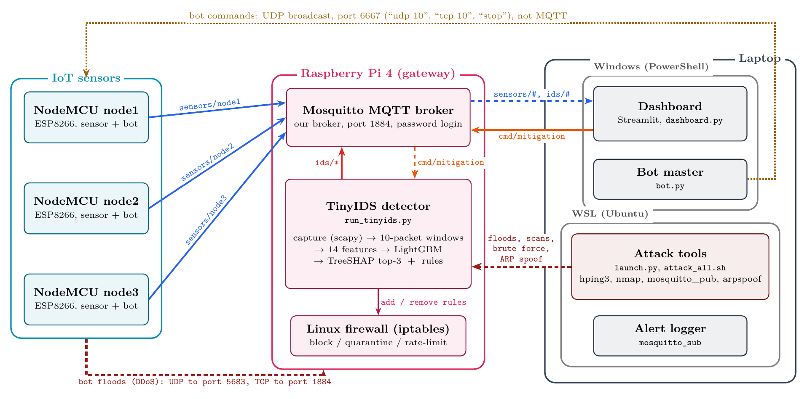
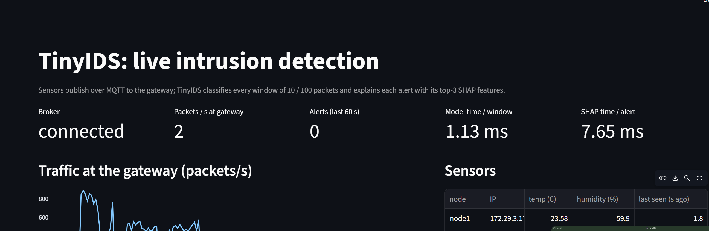

# TinyIDS

**Lightweight, explainable intrusion detection and prevention for IoT gateways, running live on a Raspberry Pi 4.**

TinyIDS watches every packet that reaches an IoT gateway, classifies each window of 10 packets per sender with a
974 KB LightGBM model, explains every alert with its top-3 SHAP features, and blocks attackers automatically with
the Linux firewall. It was built and tested on a real MQTT testbed: a Raspberry Pi 4, three NodeMCU sensors and an
attacker laptop, plus a Docker copy of the same testbed that runs on any computer.



## Highlights

| | Result | Target |
|---|---|---|
| Attack-or-benign F1 (CICIoT2023 test split, 973,829 rows) | **0.997** | ≥ 0.98 |
| False alarms | **0.97%** on the dataset, **0** on our 3 sensors live | — |
| Model size | **974 KB** | < 1 MB |
| Decision time on the Pi | **0.7–1.4 ms** per window | < 5 ms |
| SHAP explanation on the Pi | **5–14 ms** per alert | < 50 ms |
| RAM of the whole detector | **77–78 MB** | < 100 MB |

Live on the real gateway, every attack was detected and blocked: SYN, UDP, ICMP, ACK, PSH-ACK and RST-FIN floods,
a three-node botnet DDoS, port and version scans, and MQTT brute force.

## How it works

- **Model:** one LightGBM classifier → **Benign**, **Flood** or **Recon**, from 14 header features (packet sizes,
  TCP flags, protocol) that the gateway computes exactly as the CICIoT2023 dataset does.
- **Rules:** DoS vs DDoS (counting flooding senders), port scans (many ports from one sender), MQTT brute force
  (refused logins), ARP and IP spoofing (MAC ↔ IP checks).
- **Explanations:** LightGBM's built-in TreeSHAP gives the top-3 features behind every alert.
- **Mitigation:** iptables block (30 s), quarantine of a compromised sensor (120 s), rate-limit when unsure; all
  actions expire by themselves.
- **Dashboard:** Streamlit, fed over MQTT: traffic, sensors, alerts with their SHAP reasons, active blocks, IPS
  controls.



## Repository structure

| Path | Contents |
|---|---|
| `pi/` | runs on the Raspberry Pi: detector (`run_tinyids.py`, `tinyids/`), trained models (`models/top14` is deployed), broker config, start/setup scripts, RQ2 benchmark |
| `laptop/` | dashboard, attack menu (`launch.py`, `attack_all.sh`), botnet master (`bot.py`), NodeMCU firmware |
| `testbed/` | Docker testbed: gateway + 3 simulated sensors + attacker + dashboard |
| `training/` | training script and our own recorded traffic (`data/`) |
| `train_model14.ipynb` | step-by-step training notebook; rebuilds the deployed model exactly |
| `evaluation_matrices/` | evaluation script, results report, figures, the project report and explanatory PDFs |
| `RUN.md` | the lab demo, step by step |

## Quick start: Docker testbed (no hardware)

With Docker Desktop running, inside `testbed/`:

```
docker compose up -d --build
```

Open the dashboard at **http://localhost:8503**, then launch attacks against the simulated gateway:

```
docker compose exec attacker python3 launch.py 172.28.70.10
```

Botnet DDoS from the 3 simulated sensors:

```
docker compose exec attacker python3 bot.py tcp 10
```

Stop everything:

```
docker compose down
```

## Real hardware

See **[RUN.md](RUN.md)** for the full lab sequence. In short: flash `laptop/nodemcu_bot/nodemcu_bot.ino` to the
NodeMCUs with the Pi's IP, copy `pi/` to the Pi as `~/tinyids_new`, run `bash setup_pi.sh` once, then start the
broker and detector:

```
./run_ids.sh admin LAPTOP_IP
```

Then on the laptop start the dashboard (`streamlit run laptop/dashboard.py -- PI_IP`) and attack from Linux/WSL
(`python3 laptop/launch.py PI_IP`).

## Retraining

1. Download [CICIoT2023](https://www.unb.ca/cic/datasets/iotdataset-2023.html) and convert the train, validation
   and test CSVs to parquet in `cache/`.
2. Open `train_model14.ipynb` from the repository root and run all cells (≈ 2 minutes). It rebuilds
   `pi/models/top14`, checks it is identical to the deployed model, and exports the exact training rows.

## Documentation

- `evaluation_matrices/TinyIDS_Group10_IoT_Report.pdf`: the full project report (RQ1–RQ3, benchmarks, live results)
- `evaluation_matrices/TinyIDS_ML_Explained.pdf`: the system design and the machine-learning part
- `evaluation_matrices/TinyIDS_Attacks_Explained.pdf`: every attack, how it is detected and mitigated
- `evaluation_matrices/REPORT.md`: all evaluation tables (generated by `evaluate.py`)
- `TinyIDS_Proposal.pdf`: the original project proposal

## Team (Group 10, IIIT Allahabad)

Ayush Gupta (MWC2025013) · Sanket Maroti Bodhe (MWC2025005) · Meharvan Verma (MWC2025012) · Akshit Rawat (MWC2025011) ·
Alekhya China (MCL2025011) · Pritam Chaudhary (IIT2023102) · Yash Kamthan (IIT2023149)
